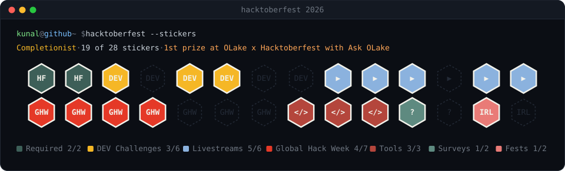
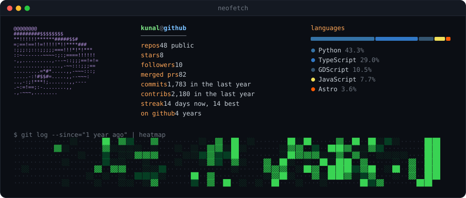

  

  <a href="https://kunalsiyag.github.io">site</a> /
  <a href="https://dev.to/kunalsiyag">dev.to</a> /
  <a href="https://medium.com/@kunal_writes">medium</a> /
  <a href="https://x.com/kunal_twts">x</a> /
  <a href="https://www.linkedin.com/in/kunalsiyag/">linkedin</a> /
  <a href="mailto:kunalsiyag1@outlook.com">email</a>

  
  
  
  
  

I like projects you can *watch*: a camera that chases a cursor, a city that argues with itself, a checkout that falls over under load. Lately that means Rust on Linux graphics, simulations run by AI agents, and tooling for the agents themselves.

### currently

- **Ambassador for GMI Cloud and Factory AI**, and a **Nebius AI Builder**. I build on their platforms in public: GridFall and Chandrapur run on GMI Cloud, and GridFall was written with Factory's Droid
- Building **[SwarmCorp](https://github.com/KunalSiyag/swarmcorp)**, mission control for fleets of coding agents

### track record

- **1st prize, OLake x Hacktoberfest 2026** with [Ask OLake](https://github.com/KunalSiyag/ask-olake), a docs bot that cites every answer and admits when it doesn't know · [write-up](https://dev.to/kunalsiyag/i-won-first-prize-at-olake-x-hacktoberfest-with-a-docs-bot-that-says-i-dont-know-4bd5)
- **$200 prize** at the Hy 3.5 preview event
- **Hacktoberfest 2026 Completionist**: 19 of 28 stickers, [sticker book below](#hacktoberfest-2026)
- **IEEE conference paper**: a quantum-network protocol with decentralized identity and post-quantum CRYSTALS-Dilithium signatures, with ML anomaly detection at 0.9795 AUC-ROC across 100K+ simulations
- **Products people use**: [proupiqr.in](https://www.proupiqr.in/) passed 14K+ impressions, and the URL shortener's package passed 700+ downloads

### featured

<table>
<tr>
<td width="50%" valign="top">

**[HyperGSR](https://github.com/KunalSiyag/gpu-recorder-rs)** · [site](https://kunalsiyag.github.io/gpu-recorder-rs/) 
Screen recorder for Linux Wayland, in Rust. Reads the cursor straight from the GPU without root, and a spring camera follows it.

</td>
<td width="50%" valign="top">

**[SwarmCorp](https://github.com/KunalSiyag/swarmcorp)** · [site](https://kunalsiyag.github.io/swarmcorp/) 
Mission control for Claude Code, Codex, Gemini CLI and opencode. Live swarm map, context meters and run receipts. Local-first.

</td>
</tr>
<tr>
<td valign="top">

**[GridFall](https://github.com/KunalSiyag/gridfall)** 
A SimCity in Godot 4 where you don't build anything. Five AI mayors run the city and about 100 AI residents complain about it.

</td>
<td valign="top">

**[BreakCart](https://github.com/KunalSiyag/breakcart)** 
A store built to break on sale day: 26 switchable production bugs, 27 incident labs, and an auditor for double charges.

</td>
</tr>
</table>

<b>more projects</b>

 

- **[Chandrapur](https://github.com/KunalSiyag/chandrapur)**: a harvest-fair day in a North Indian railway town in Three.js, with villagers you can talk to by voice
- **[ProtectedShare](https://github.com/KunalSiyag/protectedshare)** · [live](https://protectedshare.me): self-destructing links for secrets and `.env` files, encrypted in the browser
- **[ProUpiQr](https://github.com/KunalSiyag/upi-qr)** · [live](https://www.proupiqr.in/): free, local-only UPI QR codes for shops, cabs and freelancers
- **[Ask OLake](https://github.com/KunalSiyag/ask-olake)**: a docs assistant that cites every answer and admits when it doesn't know
- **[altsvg](https://github.com/KunalSiyag/altsvg)**: turns alt text into a same-size SVG placeholder, plain or in ASCII
- **[fieldcards](https://github.com/KunalSiyag/fieldcards)**: outdoor photos into printable scavenger-hunt cards, using a local Gemma model
- **[viralNest](https://github.com/KunalSiyag/viralNest)** · [live](https://pintdownload.app): find, save and reuse viral content
- **[Project North Star](https://github.com/KunalSiyag/Project-NorthStar)**: a market-data platform with a Go matching engine; held sub-3 ms P99 engine latency at 5,000 ticks/sec in a live deployment
- **[Project Atlas](https://github.com/KunalSiyag/Project-Atlas)**: a provider-independent AI agent platform in Go, starting from its inference gateway
- **[Orion](https://github.com/KunalSiyag/ContributeHub)**: a workspace for open-source contributors, from finding an issue to the merged PR
- **[URL_Shortener_DevOps](https://github.com/KunalSiyag/URL_Shortener_DevOps)**: Go + Redis + Postgres behind NGINX, with full CI/CD
- **[farmerCibil](https://github.com/KunalSiyag/farmerCibil)**, **[SmartContracts](https://github.com/KunalSiyag/SmartContracts)**: escrow and supply-chain contracts in Solidity

### writing

<!-- devto:start -->
- [I won first prize at OLake x Hacktoberfest with a docs bot that says "I don't know"](https://dev.to/kunalsiyag/i-won-first-prize-at-olake-x-hacktoberfest-with-a-docs-bot-that-says-i-dont-know-4bd5) Oct 19, 2026 · 6 min
- [What $10 of Tinker credit bought: a fine-tuned Qwen3-8B that builds small-business sites, with Gemma 4 as its art director](https://dev.to/kunalsiyag/one-sentence-in-a-website-out-a-003-a-site-side-hustle-on-a-fine-tuned-qwen3-8b-and-gemma-4-27hj) Oct 17, 2026 · 11 min
- [I built a SimCity where five AI mayors run the city, and you just watch](https://dev.to/kunalsiyag/why-every-roof-in-my-ai-run-city-was-a-mirror-and-two-other-fixes-2l8a) Oct 17, 2026 · 6 min
- [Cursor-following auto-zoom on Linux Wayland: reading the cursor from the GPU in Rust](https://dev.to/kunalsiyag/cursor-following-auto-zoom-on-linux-wayland-reading-the-cursor-from-the-gpu-in-rust-4nij) Oct 17, 2026 · 8 min
- [fieldcards: a local Gemma turns your photos into a printed scavenger hunt](https://dev.to/kunalsiyag/fieldcards-a-local-gemma-turns-your-photos-into-a-printed-scavenger-hunt-121) Oct 11, 2026 · 6 min

[all posts on DEV →](https://dev.to/kunalsiyag)
<!-- devto:end -->

### hacktoberfest 2026

  

### open source

- **[openzim/mwoffliner](https://github.com/openzim/mwoffliner)**: fixes for overlapping text and layout, and for scraper retries
- **[Apache Impala](https://gerrit.cloudera.org/#/q/owner:kunalsiyag1%2540outlook.com+status:merged)**: performance and core fixes, merged through Gerrit

### stats

  

Rust · TypeScript · Go · Python · C++ · Solidity · Godot · Three.js · Postgres · Redis · Docker · Kubernetes · AWS · Cloudflare

  

